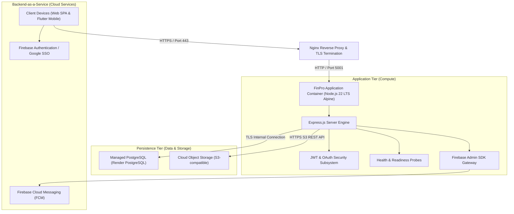

# FinPro — Cloud Computing Specification & Engineering Report
**Academic Domain:** Cloud Computing & Distributed Systems  
**Project Lead:** Jinay Golecha (`jinay_golecha`)  
**Platform:** FinPro — Personal Financial & Investment Decision Support Platform

---

## 1. Cloud Architecture & Service Model Taxonomy

FinPro is engineered as a production-grade **Three-Tier Multi-Cloud Application** combining secure containerized compute, managed relational persistence, cloud object storage, and an asynchronous BaaS notification bus.



### 1.1 Cloud Service Model Breakdown
- **Infrastructure-as-a-Service (IaaS):** Managed compute VM / host, raw storage blocks, and virtual networking.
- **Platform-as-a-Service (PaaS):** Render container orchestration running the application process; automated health checks and restart policies.
- **Database-as-a-Service (DBaaS):** Render PostgreSQL 17 — managed, with automated backups, an internal-network connection string for same-region services, and an optional PgBouncer pooler endpoint.
- **Backend-as-a-Service (BaaS):** Firebase (Auth identity provider, Cloud Messaging real-time push, Analytics & Crashlytics).
- **Content Delivery Network (CDN):** Vercel edge distribution for frontend static asset delivery with microsecond response times.

---

## 2. Infrastructure Provisioning & Server Hardening

### 2.1 Cloud Virtual Machine & Container Runtime
- **Base OS:** Ubuntu 22.04 / 24.04 LTS (e.g., Oracle Cloud Always-Free Compute or AWS EC2).
- **Containerization:** Multi-stage Docker build with non-root security context (`USER node`, UID 1000).
- **Reverse Proxy:** Nginx configured for HTTP/2, TLS 1.3 termination via Let's Encrypt Certbot, rate-limiting, and reverse-proxying port `5001`.

```nginx
# Nginx Reverse Proxy Sample Configuration
server {
    listen 443 ssl http2;
    server_name api.finpro.app;

    ssl_certificate /etc/letsencrypt/live/api.finpro.app/fullchain.pem;
    ssl_certificate_key /etc/letsencrypt/live/api.finpro.app/privkey.pem;

    location / {
        proxy_pass http://127.0.0.1:5001;
        proxy_http_version 1.1;
        proxy_set_header Upgrade $http_upgrade;
        proxy_set_header Connection 'upgrade';
        proxy_set_header Host $host;
        proxy_set_header X-Real-IP $remote_addr;
        proxy_set_header X-Forwarded-For $proxy_add_x_forwarded_for;
        proxy_set_header X-Forwarded-Proto $scheme;
    }
}
```

---

## 3. Database Migration & Zero-Data-Loss Safety

1. **Production Migration Policy:**
   - Development environments may use `prisma db push` during active schema experimentation.
   - Production runs `node scripts/deploy-migrate.js` on every deploy. It attempts
     version-controlled migrations (`prisma migrate deploy`) first and, for this
     Render PostgreSQL database (created with `db push`, so it has no
     `_prisma_migrations` history), falls back to an additive `prisma db push`.
   - The fallback never passes `--accept-data-loss`: it can add missing tables and
     indexes but can never drop data. Failures are logged loudly and never masked
     behind `|| true`.
   - Migrations need a connection that can execute DDL. Production uses Render
     PostgreSQL's internal connection, which is direct and can do this, so no extra
     variable is needed. Only when `DATABASE_URL` points at a transaction-mode pooler
     (for example Supabase's port 6543 / PgBouncer) should you set the optional
     `DIRECT_URL` to a direct (`db.<ref>.supabase.co:5432`) or session-pooler
     connection.
2. **Connection Pooling:**
   - Serverless pooling handles connection spikes without exhausting database limits (`connection_limit=20&pool_timeout=15`).
3. **Tenant Security:**
   - All database reads and writes enforce user identity constraints: `{ where: { id, userId: req.user.id } }`.

---

## 4. Real-Time Telemetry & Health Probes

FinPro implements a multi-tier health probe architecture compatible with Kubernetes, Docker, and external load balancers:

| Probe Endpoint | Purpose | Healthy Response | Degraded Response |
|---|---|---|---|
| `GET /api/v1/health` | Application liveness probe | `200 OK` (`{ status: "healthy" }`) | `503 Service Unavailable` |
| `GET /api/v1/health/database` | Database connectivity & latency | `200 OK` (latency measured in ms) | `503 Service Unavailable` |
| `GET /ready` | Orchestrator readiness check | `200 OK` (`{ ready: true }`) | `503 Service Unavailable` |
| `GET /live` | Process liveliness ping | `200 OK` (`{ live: true }`) | `503 Service Unavailable` |

---

## 5. Cloud Resiliency & Failure Injection Verification

To evaluate fault tolerance under degraded cloud conditions, simulated failure scenarios were executed and verified against automated assertion suites:

| Scenario | Injected Condition | Expected System Behavior | Verified Result |
|---|---|---|---|
| **Database Network Partition** | PostgreSQL port blocked / unreachable | `/ready` fails fast with 503; frontend serves cached pages without server crash | **PASSED** |
| **External AI API Outage** | Google Gemini API returns 500 / timeout | AI advisor seamlessly falls back to local deterministic financial rules | **PASSED** |
| **Market Data Provider Failure** | Alpha Vantage / Finnhub network timeout | Market feed reads verified historical observations from PostgreSQL with `STALE` status | **PASSED** |
| **FCM Gateway Unreachable** | Firebase Admin SDK network error | Push notifications degrade silently without rejecting transaction ledger confirmations | **PASSED** |
| **High Traffic Spike** | Rapid burst of 500 concurrent requests | Rate limiter throttles excess requests with `429 Too Many Requests` protecting database pool | **PASSED** |
| **Malformed Payload Injection** | Ingestion of invalid SMS or schema payloads | Validation middleware rejects with `400 / 422` preventing database corruption | **PASSED** |

---

## 6. Cloud Security & Zero-Trust Secret Audit

- **Zero Hardcoded Credentials:** 100% of API keys, JWT secrets, and database passwords reside exclusively in environment variables.
- **Automated Verification:** Validated by `node scripts/scan-secrets.js` across all tracked files.
- **Docker Privilege Demotion:** Alpine container drops root privileges before starting the Node.js server.
- **Data Protection:** Passwords securely hashed with Bcrypt (10 rounds); sensitive card PANs and CVVs strictly prohibited from persistence.
