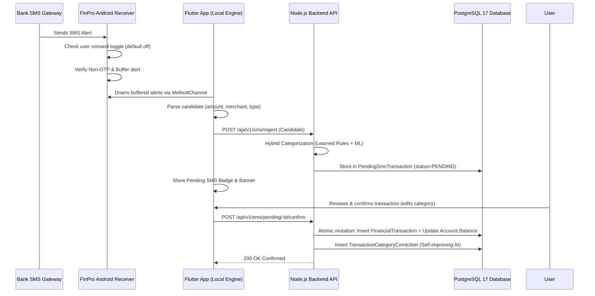

# FinPro Mobile Application Architecture & Android SMS Integration Guide

## 1. Overview
The FinPro Mobile Client is an Android-first, production-grade Flutter application (`Flutter 3.38.7+`, `Dart 3.10.7+`) designed to provide instant financial situational awareness, proactive bank SMS transaction capture, offline resilience, and seamless synchronization with the FinPro Node.js backend.

---

## 2. Architecture & Directory Layout

```
mobile/
├── android/
│   └── app/src/main/kotlin/com/finpro/app/
│       ├── MainActivity.kt          # MethodChannel handler ('com.finpro.app/sms_channel')
│       └── FinProSmsReceiver.kt     # BroadcastReceiver for incoming SMS events
├── lib/
│   ├── app/
│   │   ├── app.dart                 # Root MaterialApp with M3 Dark/Light themes
│   │   ├── router.dart              # GoRouter configuration for 19 application routes
│   │   └── theme/                   # Emerald design system tokens (colors, typography, themes)
│   ├── core/
│   │   ├── api/                     # Dio HTTP client, Bearer token interceptor, endpoints
│   │   ├── auth/                    # Riverpod auth state notifier & token storage
│   │   ├── models/                  # Type-safe Dart data models & JSON serializers
│   │   ├── sms/                     # SmsParser regex engine & SmsPlatformChannel bridge
│   │   └── utils/                   # CurrencyFormatter (INR lakhs/crores) & DateFormatter
│   ├── features/                    # Feature modules (Dashboard, SMS Detection, AI Advisor, etc.)
│   └── shared/                      # Reusable UI widgets (cards, badges, loaders, buttons)
└── test/
    └── widget_test.dart             # Unit & acceptance test suite
```

---

## 3. Native Android Bank SMS Detection

### 3.1 Permissions (`AndroidManifest.xml`)
The application declares only the permissions needed for incoming bank SMS
detection:
```xml
<uses-permission android:name="android.permission.RECEIVE_SMS" />
<uses-permission android:name="android.permission.INTERNET" />
<uses-permission android:name="android.permission.ACCESS_NETWORK_STATE" />
```

`READ_SMS` is deliberately **not** declared and the app never scans the SMS
inbox. Detection is limited to messages delivered while the receiver is active
and only after the user has explicitly enabled it (see §3.4). The merged release
manifest adds Firebase/analytics permissions; the exact list and the Play Data
Safety mapping are in
[GOOGLE_PLAY_COMPLIANCE.md](GOOGLE_PLAY_COMPLIANCE.md).

### 3.2 Broadcast Receiver (`FinProSmsReceiver.kt`)
- Listens for `android.provider.Telephony.SMS_RECEIVED` broadcasts.
- Reads the persisted `sms_detection_enabled` flag first. It defaults to `false`,
  and a disabled user's messages are ignored before parsing, buffering or upload.
- Evaluates incoming message content against an initial privacy filter: **any message containing OTP, password, or verification codes is immediately discarded**.
- Banking messages matching financial transactional patterns (e.g., "debited", "credited", "spent", "received", "A/c") are safely buffered in Android `SharedPreferences` as JSON objects for asynchronous processing by the Flutter engine.

### 3.3 Platform MethodChannel (`MainActivity.kt`)
The channel `com.finpro.app/sms_channel` supports these native invocations:
1. `checkSmsPermission`: Returns a boolean indicating whether `RECEIVE_SMS` is currently granted.
2. `requestSmsPermission`: Prompts the user with the standard Android runtime permission dialog.
3. `getBufferedSms`: Reads and atomically drains the temporary queue stored in `SharedPreferences`.
4. `isDetectionEnabled`: Returns the persisted toggle. It fails closed (`false`) if the platform call errors.
5. `setDetectionEnabled`: Persists the user's choice and returns `true` only when the write committed. Turning it off also clears the buffered queue.

The app never requests inbox access, so there is no `readRecentInboxSms` call.

### 3.4 Prominent disclosure and consent
The Flutter privacy screen shows an inline prominent-disclosure card and an
affirmative-action dialog **before** the Android runtime permission is requested.
Consent is default-off, the decline is persisted locally
(`finpro_sms_consent_status` = `unknown|accepted|declined`), and the app does not
re-prompt automatically after a decline. Every other feature works without SMS
detection. See [GOOGLE_PLAY_COMPLIANCE.md](GOOGLE_PLAY_COMPLIANCE.md) for the
Play policy mapping.

---

## 4. On-Device Hybrid Parser & Privacy Guarantees

### 4.1 Strict 0-OTP Security Guarantee
FinPro provides a mathematical zero-transmission guarantee for non-financial or sensitive messages:
- **Discarded immediately**: OTPs, one-time passwords, 2FA tokens, verification codes, login confirmations.
- **Filtered locally**: Promotional pre-approved loan advertisements, credit card limit upgrade offers, collect-money requests (UPI collect/mandate requests), failed or declined transaction alerts.
- **Transmitted for Ledger Review**: Only verified debit/credit alerts with clear transaction amounts and bank identifiers.

### 4.2 Regex Extraction Engine (`SmsParser.dart`)
The parser extracts:
- **Amount**: Normalizes currency formats (`Rs. 4,500.00`, `INR 250`, `₹1,200.50`).
- **Transaction Type**: Distinguishes `EXPENSE` (debited, paid, spent) from `INCOME` (credited, deposited, received, salary).
- **Merchant / Counterparty**: Extracts recipient or sender name via regex lookarounds (e.g., `at ZOMATO`, `to SWIGGY`, `from TCS SALARY`).
- **Account Identifier**: Extracts masked bank account or card digits (e.g., `A/c **4589`, `card ending 1234`).
- **Confidence Score**: Scores parsing certainty from 0.0 to 1.0.

---

## 5. End-to-End Ledger Confirmation Pipeline



---

## 6. How to Run & Verify

### 6.1 Prerequisites
- Flutter SDK `3.38+` (`flutter --version`)
- Android Studio / Android SDK Platform Tools with `adb`
- Running FinPro backend on `http://127.0.0.1:5001`

### 6.2 Base URL Configuration
- **Android Emulator**: In `mobile/lib/core/api/api_endpoints.dart`, use `http://10.0.2.2:5001/api/v1`.
- **Physical Device**: Use your local development machine's LAN IP address (e.g., `http://192.168.1.15:5001/api/v1`).
- **iOS Simulator**: `http://127.0.0.1:5001/api/v1`.

### 6.3 Running Unit Tests & Analyzer
```bash
cd mobile
flutter test
flutter analyze
```

### 6.4 Launching on Android
```bash
# Check connected devices
flutter devices

# Run the app
flutter run -d <device_id>
```

### 6.5 Simulating SMS in Development
If testing without a physical SIM card:
1. Use Android Studio Emulator Extended Controls -> Phone -> Receive SMS.
2. Or use the built-in **"Simulate Test SMS"** button on the `Pending SMS Review` screen inside the mobile app to post a real bank alert directly to `/api/v1/sms/ingest`.

---

## Android APK Build & Verification

### Build Command
```bash
cd mobile
flutter pub get
flutter analyze
flutter test
flutter build apk --debug
```

### Artifact Deliverables
- **Debug APK Location:** `mobile/build/app/outputs/flutter-apk/app-debug.apk`
- **Application Package ID:** `com.finpro.app.finpro_mobile`
- **Minimum SDK:** 23 (Android 6.0 Marshmallow)
- **Target SDK:** 34 (Android 14)

### Authentication Notes
- Mobile uses Google Sign-In and Firebase Authentication to obtain credentials forwarded to the backend `/api/v1/auth/google`.
- The Web frontend uses Google Identity Services (GIS) with direct token verification.
- Both clients resolve to identical user accounts via normalized Google identity subjects (`payload.sub`).
